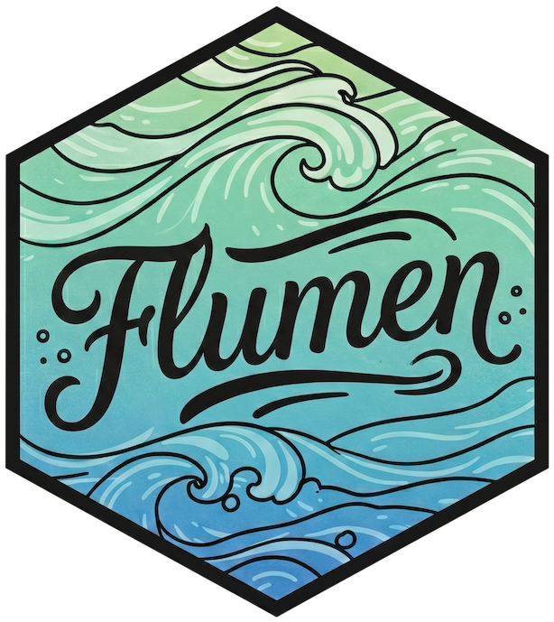

<h1>Flumen</h1>



Flumen is a workflow management system for distributed bioinformatics
pipelines. It runs inside your R session and schedules a DAG of R,
Python and shell tasks across worker processes, on a single machine or
across several hosts over TCP. Outputs move over sockets from the worker
that produced them to the worker that needs them, so no centralized
storage is required. Vectors, matrices and data frames cross as Apache
Arrow IPC, which is also what lets a Python task read them natively,
while other objects cross with an R-only serialization and require R tasks. Wildcards parametrise
the DAG, which expands at build time where the values are known and at
run time where a task discovers them.<br clear="right"/>

## Installation

``` r
# install.packages("remotes")
remotes::install_github("simo1c/Flumen")
```

Windows is not currently supported.

Installing from source compiles a small amount of C++, so a compiler is
needed. For Python tasks, the interpreter on every worker that runs them
needs:

``` bash
pip3 install pyarrow pandas numpy pynng
```

## Quick start

A workflow expands over a set of values, runs one task instance per
value, and aggregates the results back into a single task.

``` r
library(flumen)

# Wildcards parametrise the pipeline: three values, so three instances of A.
w_list <- new_wildcard_list(sample = c("s1", "s2", "s3"))

# Task A: one instance per {sample}, each returning an object.
A <- new_R_task(
  task_id = "A",
  input   = new_input(x = new_object_exp("{sample}")),
  output  = new_output(out = new_object("{{out}}")),
  exec    = new_script('
    f <- function(x) paste("processed", x)
  ')
)

# Task B: one instance, receiving every A output as a list.
B <- new_R_task(
  task_id = "B",
  input   = new_input(xs = new_dep(task_id = "A", value = new_object_aggr("{{out}}"))),
  output  = new_output(final = new_object("{{final}}")),
  exec    = new_script('
    function(xs){
      g <- paste(unlist(xs), collapse = "; ")
      saveRDS(g, "test.Rds")
    }
  ')
)

workflow <- new_workflow(
  workflow_id   = "workflow",
  desc          = "Expand A over {sample}, aggregate in B",
  task_list     = list(A, B),
  wildcard_list = w_list
)

plot(workflow)

run_workflow(
  workflow,
  worker_list = list(new_worker(name = "w1", n_concurrent_task = 1))
)
```

This writes `test.Rds` in the working directory, containing
`"processed s1; processed s2; processed s3"`.

## Documentation

- [Getting started](https://github.com/simo1c/Flumen/blob/main/docs/getting-started.md): basic concepts to start with Flumen.
- [A multi-language pipeline](https://github.com/simo1c/Flumen/blob/main/docs/scrnaseq-annotation.md): a scRNA-seq 
  pipeline across three machines with no shared filesystem.
- [Flumen DSL](https://github.com/simo1c/Flumen/blob/main/docs/FLUMEN_DSL.md): the complete reference and an 
  LLM-friendly resource for automatic workflow construction.


## Citation

This entry will be replaced by the published reference and its DOI.

## License

Flumen is distributed under the [MIT license](https://github.com/simo1c/Flumen/blob/main/LICENSE.md).
